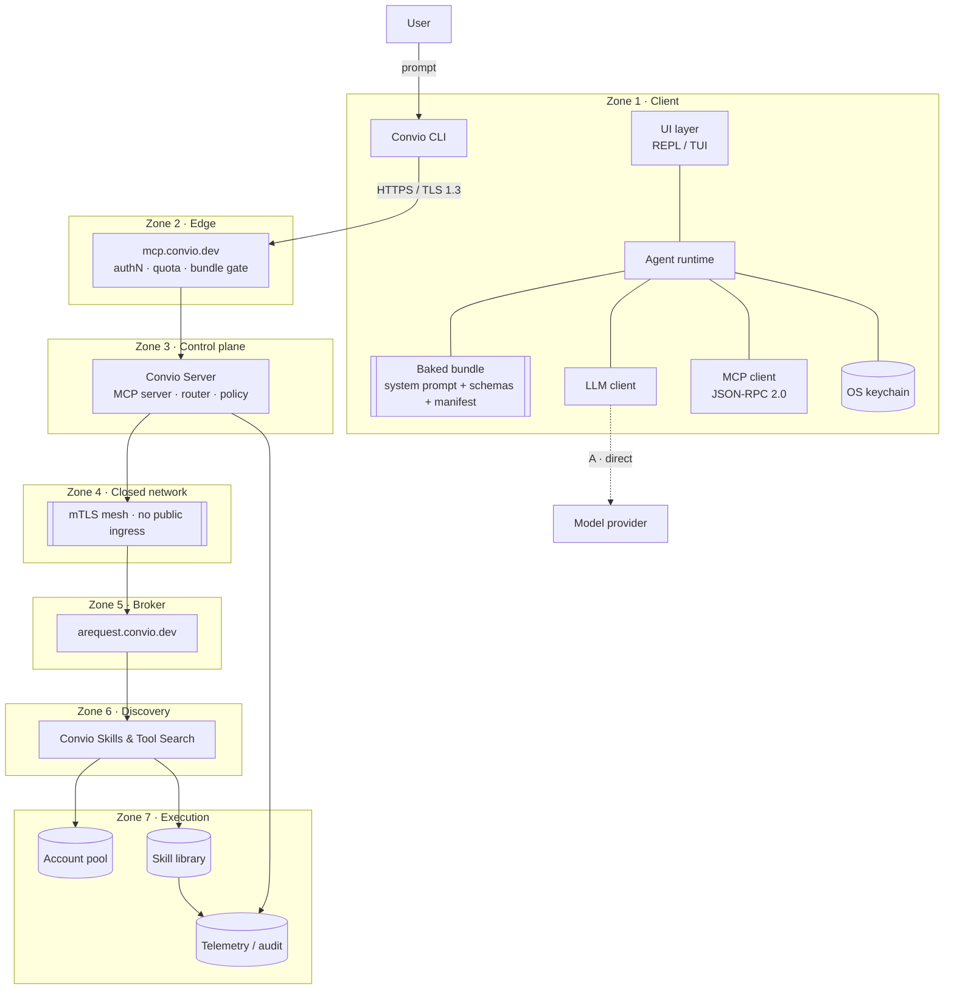

# Convio CLI — Architecture

> Goal: a CLI that talks to `mcp.convio.dev` with the **system prompt baked into the binary**,
> while keeping the existing backend chain unchanged.

---

## 1. What changes vs. today

| | Today | With CLI |
|---|---|---|
| Entry point | User is inside some MCP host (Claude, Cursor…) | User runs `convio` directly |
| System prompt lives | Server / host prompt | **Baked into CLI at build time** |
| Instruction authority | `mcp.convio.dev` | CLI bundle + version gate at edge |
| Tool execution | Unchanged | Unchanged |
| Auth | Host OAuth | CLI owns OAuth 2.1 + PKCE, token in OS keychain |
| Path | MCP → Server → AREQUEST → CTS | **CLI → MCP → Server → AREQUEST → CTS** |

The backend chain is untouched. Only the *front door* and the *instruction source* move.

---

## 2. Layered diagram (trust zones)

```
┌──────────────────────────────────────────────────────────────────────────────┐
│  ZONE 0 · END USER                                                           │
│                                                                              │
│    User ──► prompt · slash command · tool-approval · interrupt (Ctrl-C)       │
└───────────────────────────────────┬──────────────────────────────────────────┘
                                    │ local TTY (stdin/stdout)
┌───────────────────────────────────▼──────────────────────────────────────────┐
│  ZONE 1 · CLIENT            laptop / CI runner / devcontainer                │
│                                                                              │
│  ┌────────────────────────────────────────────────────────────────────────┐  │
│  │ CONVIO CLI                                                             │  │
│  │                                                                        │  │
│  │  ┌──────────────┐  ┌────────────────┐  ┌────────────────────────────┐  │  │
│  │  │ UI LAYER     │  │ AGENT RUNTIME  │  │ BAKED BUNDLE               │  │  │
│  │  │ REPL / TUI   │  │ context builder│  │ system prompt (identity,   │  │  │
│  │  │ stream render│  │ plan→act→obs   │  │   behavior, guardrails)    │  │  │
│  │  │ approval UX  │  │ retry / budget │  │ tool schemas (no secrets)  │  │  │
│  │  └──────┬───────┘  └───┬────────┬───┘  │ skill manifest (semver)    │  │  │
│  │         │              │        │      │ model routing policy       │  │  │
│  │  ┌──────▼──────────────▼──┐     │      │ BUNDLE_VERSION + sha256    │  │  │
│  │  │ LLM CLIENT             │     │      └────────────────────────────┘  │  │
│  │  │ provider adapters      │     │                                      │  │
│  │  │ (Anthropic/OpenAI/…)   │     │  ┌────────────────────────────────┐  │  │
│  │  └───────────┬────────────┘     └─►│ MCP CLIENT                     │  │  │
│  │              │                     │ JSON-RPC 2.0                   │  │  │
│  │              │                     │ streamable HTTP + SSE          │  │  │
│  │              │                     │ initialize · list · call       │  │  │
│  │              │                     └───────────────┬────────────────┘  │  │
│  │  ┌───────────┴────────────┐                        │                   │  │
│  │  │ SECRET STORE           │                        │                   │  │
│  │  │ OS keychain · OAuth PKCE│                       │                   │  │
│  │  └────────────────────────┘                        │                   │  │
│  └────────────────────────────────────────────────────┼───────────────────┘  │
└───────────────────────────────┬───────────────────────┼──────────────────────┘
                                │                       │
                     (A) direct │ TLS 1.3     (B) HTTPS │ TLS 1.3
                                ▼                       ▼
┌──────────────────────────────────────────────────────────────────────────────┐
│  ZONE 2 · EDGE                    mcp.convio.dev                             │
│                                                                              │
│   authN (OAuth2/OIDC) · session manager · rate limit · quota · WAF           │
│   bundle-version gate        min 1.3.0 │ received 1.4.0 ✓                    │
│   MCP protocol negotiation   capabilities · tool-set pinning                 │
│   [optional] inference proxy ───────────── only used on branch (B)           │
└───────────────────────────────────┬──────────────────────────────────────────┘
                                    │ private link / mTLS
                                    ▼
┌──────────────────────────────────────────────────────────────────────────────┐
│  ZONE 3 · CONTROL PLANE                 Convio Server                        │
│                                                                              │
│   MCP SERVER   tools/list · tools/call · resources/read · prompts/list       │
│   session state · bundle pinning · per-tenant policy (OPA) · entitlements    │
│   TOOL ROUTER  ──► (a) native tools   (b) AREQUEST broker   (c) CTS search   │
└───────────────────────────────────┬──────────────────────────────────────────┘
                                    │
╔═══════════════════════════════════╧══════════════════════════════════════════╗
║  ZONE 4 · CONVIO INTERNAL CLOSED NETWORK   ·  no public ingress  ·  mTLS mesh ║
╚═══════════════════════════════════╤══════════════════════════════════════════╝
                                    ▼
┌──────────────────────────────────────────────────────────────────────────────┐
│  ZONE 5 · REQUEST BROKER              arequest.convio.dev                    │
│   deserialize → authorize → resolve skill → fan-out → aggregate → normalize  │
└───────────────────────────────────┬──────────────────────────────────────────┘
                                    ▼
┌──────────────────────────────────────────────────────────────────────────────┐
│  ZONE 6 · DISCOVERY        Convio Skills & Tool Search (CTS)                 │
│   semantic index (embeddings) · skill registry · capability graph · ranking  │
└───────────────────────────────────┬──────────────────────────────────────────┘
                                    ▼
┌──────────────────────────────────────────────────────────────────────────────┐
│  ZONE 7 · EXECUTION PLANE                                                    │
│                                                                              │
│  ┌──────────────────┐  ┌──────────────────┐  ┌───────────────────────────┐   │
│  │ ACCOUNT POOL     │  │ SKILL LIBRARY    │  │ OBSERVABILITY             │   │
│  │ credential rotate│  │ versioned skills │  │ traces · audit · metering │   │
│  │ tenant isolation │  │ sandboxed exec   │  │ OpenTelemetry             │   │
│  └──────────────────┘  └──────────────────┘  └───────────────────────────┘   │
└──────────────────────────────────────────────────────────────────────────────┘
```

---

## 3. Request lifecycle

```
USER          CLI                    EDGE                 BACKEND
 │             │                      │                     │
 ├─ prompt ───►│                      │                     │
 │             ├─ build messages       │                     │
 │             │  [system(baked)]      │                     │
 │             │  + history + user     │                     │
 │             ├──── (A) LLM provider directly ─────────────►│
 │             │◄─── tool_call ────────┘                     │
 │             │                      │                     │
 │             ├─ tools/call ─────────►│                     │
 │             │   + bundle {ver,hash} │                     │
 │             │                      ├─ authZ/quota ───────►│
 │             │                      ├─ route ────────────►│ Convio Server
 │             │                      │                     ├─ AREQUEST
 │             │                      │                     ├─ CTS search
 │             │                      │                     ├─ account pool
 │             │                      │                     ├─ skill exec
 │             │◄── result ───────────┤◄────────────────────┤
 │             ├─ append tool result   │                     │
 │             ├─ (A) LLM again ───────────────────────────►│
 │◄── stream ──┤◄── final answer ─────┘                     │
 │             │                      │                     │
```

Loop continues until the model emits no more `tool_call`s or the runtime hits
`max_turns` / token budget / user interrupt.

---

## 4. Handshake (why the baked bundle still needs the server)

```
CLI boot
  │
  ├─ load baked bundle   { version: 1.4.0, hash: sha256:9f2c… }
  │  (compiled in, works offline, zero fetch cost)
  │
  ├─ MCP initialize ──────────────────────────► mcp.convio.dev
  │    protocolVersion, clientInfo,
  │    bundleVersion, bundleHash, toolSetHash
  │
  │◄────────── serverCapabilities, acceptedTools,
  │            minBundleVersion, entitlementSet
  │
  ├─ if accepted  → session established, proceed
  └─ if stale     → warn / block / fetch signed prompt-pack patch
```

**Rule:** baked prompt = *default identity*. Server = *compatibility & entitlements*.
The CLI never sends credentials upstream as part of the prompt; it only sends a
version + hash so the server can refuse an outdated client.

---

## 5. Baked bundle lifecycle

```
prompts/system.md ─┐
tools.manifest.json├─► scripts/build-bundle.ts ─► packages/bundle/prompt.generated.ts
skills.manifest.json┘        (markdown → const, + sha256)          │
                                                                   ▼
                                                    bundled into binary (tsup / bun build --compile)
                                                                   │
                                          ┌────────────────────────┴────────────────────────┐
                                          ▼                                                 ▼
                              releases with the CLI                              ~/.convio/cache/prompt-*.json
                              (next minor bump)                                 signed hot-patch, fallback = baked
```

Baked artifacts (never fetched at runtime for correctness):
- `system.md` — identity, tone, guardrails, refusal policy
- `tools.manifest.json` — names + JSON Schemas (contract only)
- `skills.manifest.json` — ids, semver, descriptions, capability tags
- `routing.json` — model selection + token budget

Server-only (never baked): secrets, entitlements, execution logic, embeddings, audit.

---

## 6. Framework / stack choices

| Concern | Recommended | Alternative |
|---|---|---|
| Language | TypeScript | Go, Rust |
| CLI framework | `commander` + `@clack/prompts` | `oclif`, `clipanion` |
| TUI | `ink` (React) | `ratatui`, raw `readline` |
| MCP | `@modelcontextprotocol/sdk` | hand-rolled JSON-RPC 2.0 |
| Transport | streamable HTTP + SSE | stdio (local only) |
| Validation | `zod` | `valibot` |
| Auth | OAuth 2.1 + PKCE, `keytar` | device-code flow |
| Config | `cosmiconfig` | `dotenv` only |
| Build | `tsup` + `bun build --compile` | `pkg`, `nexe` |
| Telemetry | OpenTelemetry SDK | custom events |
| Tests | `vitest` + `msw` | `node:test` |

---

## 7. Suggested repo layout

```
convio/
├─ packages/
│  ├─ cli/          entrypoint, commands, interactive shell
│  ├─ runtime/      agent loop, context builder, token budget, retries
│  ├─ mcp-client/   JSON-RPC transport, reconnect, capability cache
│  ├─ llm/          provider adapters + streaming normalization
│  ├─ bundle/       generated prompt/schema artifacts (read-only)
│  └─ config/       cosmiconfig + zod schemas
├─ prompts/
│  ├─ system.md
│  ├─ tools.manifest.json
│  └─ skills.manifest.json
├─ scripts/
│  └─ build-bundle.ts
└─ dist/            single binary per platform
```

---

## 8. Decisions that matter

1. **Where inference happens.** (A) CLI calls the model provider directly — lower
   latency, user pays their own key, but the prompt leaves the Convio perimeter.
   (B) proxy through `mcp.convio.dev` — central metering/audit, but adds a hop and
   makes the CLI useless offline. Recommend (A) + optional (B) for teams.
2. **Prompt drift.** Baked prompts go stale across releases. Mitigate with the
   `bundleVersion` handshake and a signed hot-patch cache, baked bundle as fallback.
3. **Tool schemas vs. execution.** Bake schemas so the model can plan offline;
   never bake execution, credentials, or account-pool routing.
4. **MCP is a tool protocol, not an inference protocol.** Keep the LLM client and
   the MCP client as two independent spines inside the CLI.

---

## 9. Mermaid (renders on GitHub)

```mermaid
sequenceDiagram
    autonumber
    participant U as User
    participant C as Convio CLI
    participant E as mcp.convio.dev
    participant S as Convio Server
    participant A as AREQUEST
    participant T as CTS

    U->>C: prompt
    C->>C: build context [system(baked) + history]
    C->>C: LLM call → tool_call
    C->>E: tools/call + bundle{ver,hash}
    E->>E: authZ / quota / version gate
    E->>S: forward
    S->>A: resolve request
    A->>T: semantic skill search
    T-->>A: ranked skills + handles
    A-->>S: normalized result
    S-->>E: MCP result
    E-->>C: result
    C->>C: append + re-invoke LLM
    C-->>U: streamed answer
```




